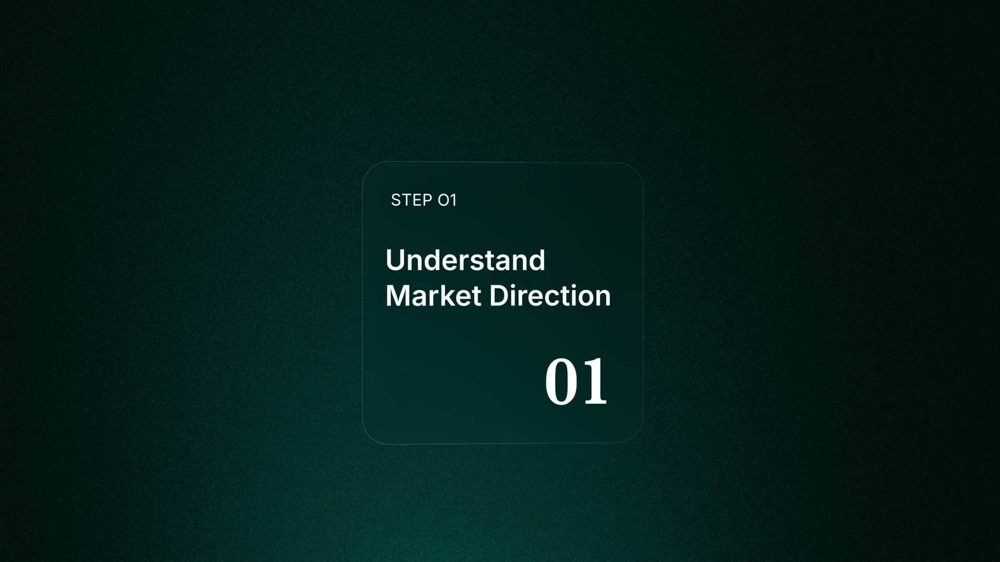
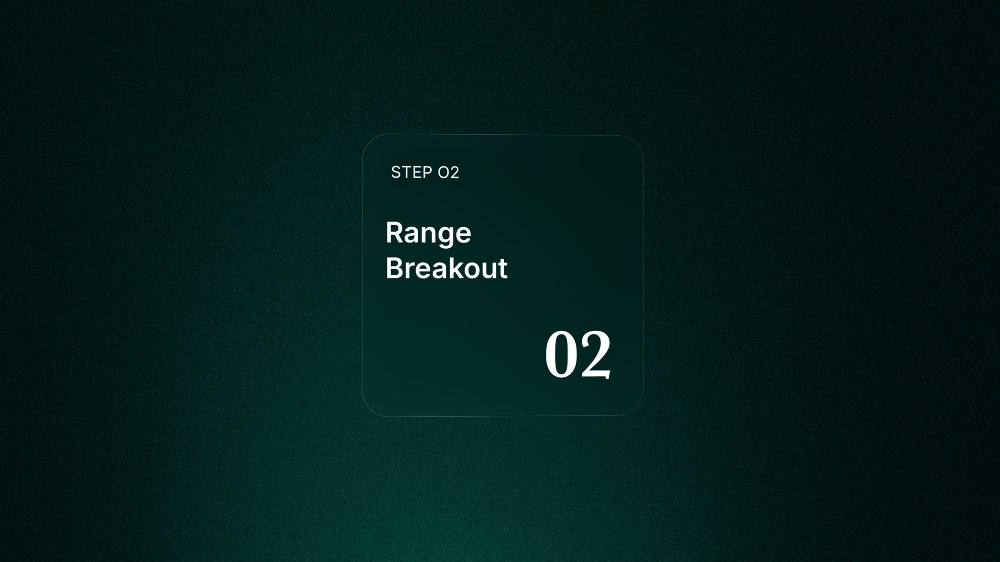
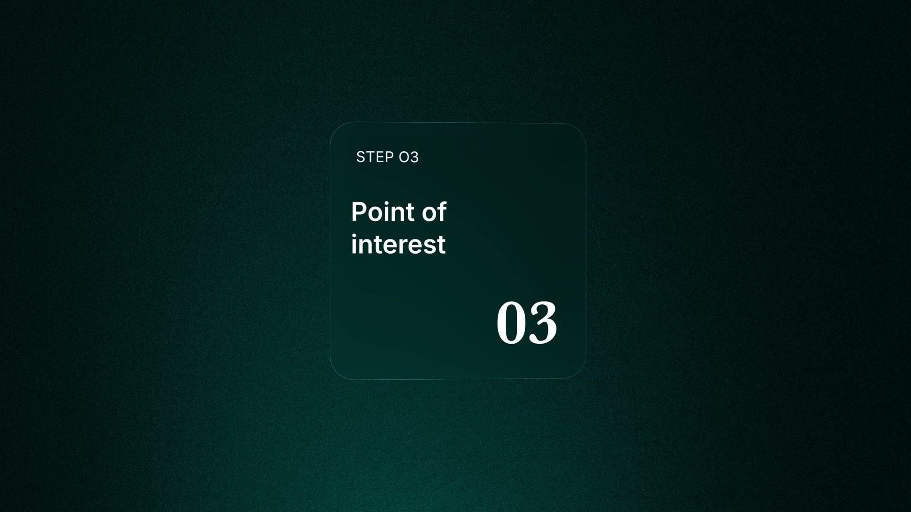
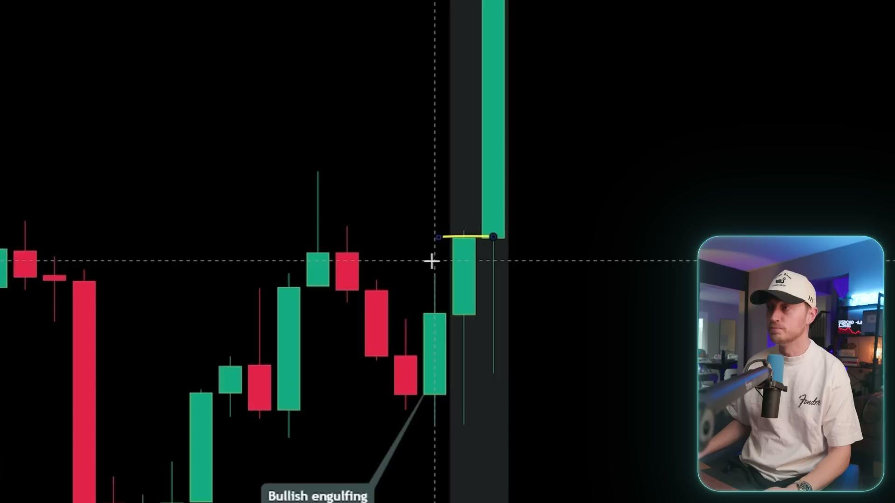
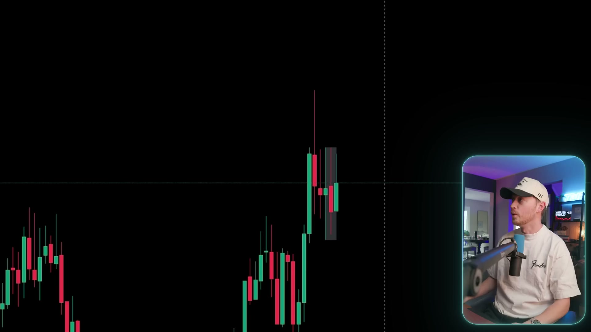
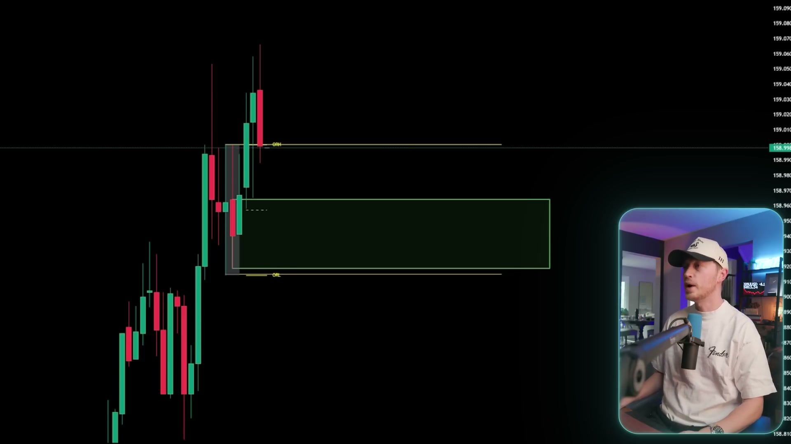
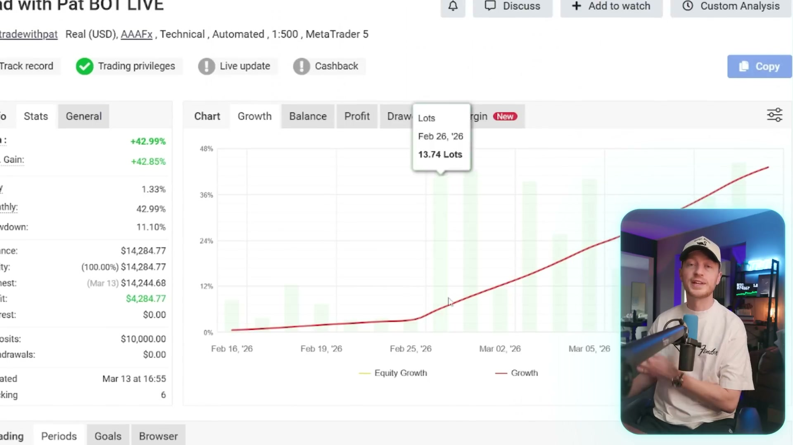
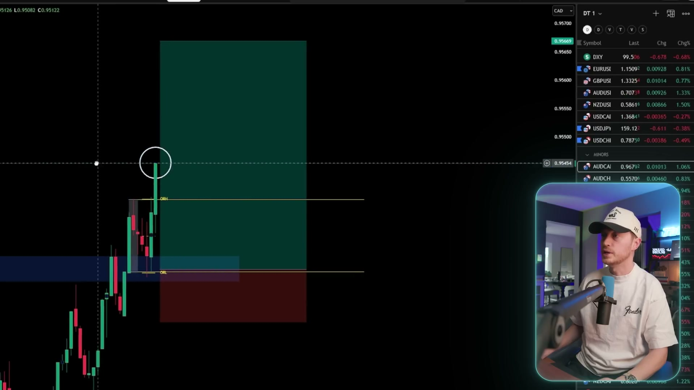
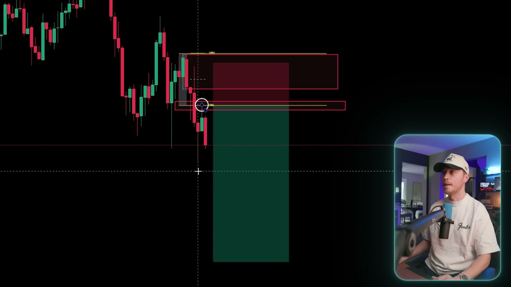

> Current user-requested mode: **24/7 crypto**, using rolling references; no 7/8 a.m., New York session or weekday restriction. See [current bot rules](strategy-review-2026-09-18/README.md#500-backtest-v1--247-crypto-adaptation).

> Superseded where conflicting: [video and narration re-review, corrected bot rules](strategy-review-2026-09-18/README.md). Earlier extraction missed important narrated rules; do not treat the historical analysis below as the current specification.

# 500 Backtest V1 — strategy extracted from the video

**Source:** `docs/video docs/3 Step BEGINNER Scalping Strategy (500 Trade BACKTEST)_54.mp4`
**Length:** 10:49, 1920x1080, 25fps
**Extracted:** 2026-09-18, from video frames only

---

## How this was extracted, and what that means

Frames were pulled with ffmpeg and read directly. Title cards were located by
scanning every second of the video for flat, strongly green, low-variance
frames, which separates a slide from a candlestick chart or a webcam shot.

**The audio was not used.** There is no transcription capability here, so
anything stated only in narration and never shown on screen is not in this
document. Where a rule is visible, it is cited with a timestamp and a
screenshot. Where a rule would normally exist but was not shown, it is listed
under Unknowns rather than guessed at. Treat the Unknowns as genuinely open,
because a plausible-sounding invention is worse than an admitted gap when the
output places real orders.

---

## The three steps

| Step | Title | Timestamp |
|---|---|---|
| 01 | Understand Market Direction | 1:05 |
| 02 | Range Breakout | 2:54 |
| 03 | Point of Interest | 4:31 |

---

## What the strategy actually is

An **Opening Range Breakout**, anchored to the New York Stock Exchange open.

### Step 01 — Understand Market Direction

Direction is established before any entry is considered. The clearest evidence
on screen is a higher-timeframe candle read together with a candlestick
pattern: a 1-hour chart on Gold annotated **8:00 AM CANDLE** with a **Bearish
engulfing** label on the candle that turns the move.

What is visible: a session-anchored reference candle, a named reversal pattern,
and a 1-hour chart. What is not visible: how direction is scored, whether the
engulfing pattern is required or illustrative, and what happens when the
higher-timeframe read and the breakout disagree.

### Step 02 — Range Breakout

The range is explicitly defined on screen as **the first 15 minutes of the New
York Stock Exchange**, which is 09:30 to 09:45 New York time.

The high and low of that window are drawn as horizontal lines and labelled
**ORH** and **ORL**, with the body of the range shaded.

The tool doing this is a TradingView indicator identified in the chart legend
as **LuxAlgo - ORB & Targets**, with a session setting shown as
`Sessions 0900-1600 1230-1300`.

A trade is taken when price breaks out of that range: above ORH for a long,
below ORL for a short.

### Step 03 — Point of Interest

The breakout is not taken in isolation. It is filtered by a level, annotated on
screen as **RESISTANCE**, with the breakout occurring at that level.

### Risk and target

Both sides are shown with the TradingView position tool: a red risk box and a
green reward box.

- **Long:** entry on the break above ORH, stop below the range, target above.
- **Short:** entry on the break below ORL, stop above the range, target below.

The stop sits on the opposite side of the opening range from the entry. The
reward box is visibly larger than the risk box in the examples, but the exact
multiple is never stated numerically on screen.

---

## Instruments and timeframes actually shown

| Instrument | Venue | Chart timeframe |
|---|---|---|
| US100 (Nasdaq 100) | Capital.com | 1h |
| Gold (XAU/USD) | TVC | 1h |
| USD/CAD | OANDA | 5m |

**No cryptocurrency appears anywhere in the video.**

---

## Unknowns

These would normally be specified and were not visible. They are the difference
between a strategy and a sketch, and each one changes the result materially.

1. **The exact entry trigger.** Whether a candle must close beyond the range,
   or a touch is enough, or a retest is required. Close-versus-touch alone
   typically moves the win rate by several points.
2. **The reward multiple.** The boxes look larger than 1:1 but no number is
   shown.
3. **How the point of interest is chosen.** What qualifies as a level, and how
   far from it a breakout may occur and still count.
4. **What invalidates a setup.** Time cutoff, a second breakout in the
   opposite direction, a maximum range width.
5. **Position sizing.** Never shown.
6. **The backtest itself.** The title claims 500 trades. No results table,
   equity curve, win rate, profit factor or drawdown appears in any frame
   examined. The instruments, period and cost assumptions behind that number
   are unknown, and a backtest without stated costs is not evidence for a
   strategy that trades frequently.

---

## The problem with porting this to our system

This matters more than any of the unknowns above, so it is stated plainly.

**The strategy is anchored to the New York Stock Exchange opening bell.** Its
entire premise is that a known, scheduled event concentrates order flow into a
fifteen-minute window, producing a range whose break carries information.

**Binance USDT perpetuals trade 24 hours a day and have no opening bell.**
There is no fifteen-minute window where the market reopens after being closed,
because it never closed. The mechanism that is supposed to make the range
meaningful does not exist on our instruments.

Three honest options follow.

**Adapt the anchor.** Crypto does react to the US equity open, and the research
already in this project found crypto volume peaking between 13:00 and 17:00
UTC, with the NYSE open at 13:30 UTC inside that window. An opening range built
on 13:30 to 13:45 UTC is a defensible crypto analogue. It is an adaptation, not
the video strategy, and the video backtest says nothing about whether it works.

**Use the daily open instead.** 00:00 UTC is the closest thing crypto has to a
session boundary and is already the anchor for the VWAP in the existing
strategy. Also defensible, also unevidenced.

**Do not build it.** The strategy may simply not transfer.

Whichever is chosen, the 500-trade claim in the title does not carry over. It
was measured on indices, gold and a currency pair, on a session structure our
instruments do not have. Any version of this running on crypto perpetuals needs
its own validation before it is trusted with anything.
