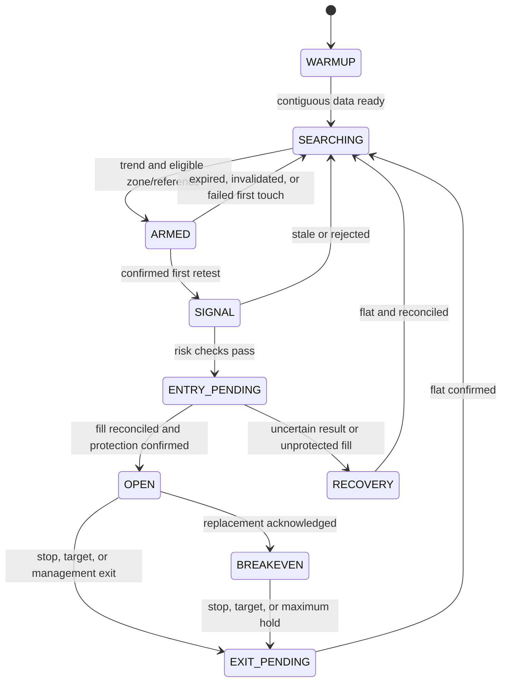

# Deterministic bot specification — research baseline v0.1

Everything numerical in this file is **proposed**, except the observed one-ATR stop multiplier. The goal is reproducible research, not a claim that the presenter used these calculations.

## 1. Data and timing

Use finalized standard one-minute OHLCV bars with UTC open/close timestamps. Each symbol has an independent state. Reject duplicate bars, impossible OHLC values, negative volume, and missing intervals. Pause new entries after a gap until historical continuity is restored and indicators are recomputed.

Use at least 200 contiguous closed bars for initial warmup. Process bars in chronological order. Decisions may use only information available at that close; an order based on bar `t` cannot fill earlier than after its close. Use trade/quote events for live fills and stop management.

True range is `max(H-L, abs(H-C_previous), abs(L-C_previous))`. Seed ATR with the arithmetic mean of the first 14 valid true ranges, then use `(13 * ATR_previous + TR_current) / 14`. Freeze `ATR_t` at the signal close for that trade. Displacement thresholds use `ATR_(d-1)` so the displacement bar does not inflate its own threshold.

## 2. Confirmed structure

A pivot high at `i` has a strictly higher high than bars `i-2`, `i-1`, `i+1`, and `i+2`. A pivot low is the strict lower-low equivalent. Equal values do not qualify. A pivot becomes available only at the close of `i+2`.

An uptrend exists when the latest two available pivot highs rise and the latest two available pivot lows rise. Require the underlying pivot indices to alternate in time; otherwise report insufficient/ambiguous structure. Store both pivot time and confirmation time.

When a zone is armed, freeze this trend context and its most recent structural low. Reject the zone if a subsequent candle closes below that structural low before the first touch. A wick sweep is allowed. Do not demand newly rising pivots on every pullback candle, which would erase the setup being tested.

## 3. Demand-zone creation

At each bullish closed bar `d`, look at candidate bases consisting of the immediately preceding one, two, or three candles. For each candidate require:

- Every base candle's range is at most `ATR_(d-1)`.
- The combined base range is at most `ATR_(d-1)` and greater than zero.
- `C_d > O_d` and `C_d - O_d >= 1.5 * ATR_(d-1)`.
- `C_d` exceeds the base high and its close location `(C_d-L_d)/(H_d-L_d)` is at least 0.75.

Choose the longest qualifying base. Set `zone_low` to its minimum low and `zone_high` to its maximum high. The zone becomes available at `d` close; never backdate its availability to the base. Save base indices, bounds, displacement index, and prior ATR. Require bullish structure at `d` close to arm it.

This is a base-and-displacement proxy for the video's discretionary rectangle; it is not a mandatory fair-value-gap detector.

## 4. Associate the liquidity reference

At arming, choose the latest confirmed pivot low `P` known at `d` close whose pivot index is within the preceding 30 bars and whose price lies between `zone_high - 0.25 * ATR_(d-1)` and `zone_high + 0.5 * ATR_(d-1)` inclusive. It must be above `zone_low`. If none exists, discard the candidate. Freeze this reference; do not retrofit a later low after seeing a successful bounce.

Keep only the newest eligible armed zone per symbol. A newer eligible zone replaces an untouched older zone. Expire a zone after 60 bars following its displacement. Invalidate it on any subsequent close below `zone_low`. Do not count the displacement/base as a retest.

## 5. First retest, sweep, and rejection

The first later bar `t > d` whose range overlaps `[zone_low, zone_high]` is the first retest. Evaluate it once at close. Require all of:

| Condition | Formula |
|---|---|
| Zone contact | `L_t <= zone_high` and `H_t >= zone_low` |
| Sweep | `L_t <= P - tick_size` |
| Reclaim | `C_t > max(P, zone_high)` |
| Bullish candle | `C_t > O_t` |
| Close near high | `(C_t-L_t)/(H_t-L_t) >= 0.65` |
| Lower-wick rejection | `(min(O_t,C_t)-L_t)/(H_t-L_t) >= 0.25` |
| Volume expansion | `V_t >= 1.5 * mean(V_(t-20)..V_(t-1))` |

Reject zero-range candles and missing/nonpositive volume baselines. Discard a zone after its first touch whether or not a signal qualifies. This one-bar confirmation and first-touch policy is deliberately stricter than the video's unquantified discretion; test multi-bar variants separately.

Before evaluating a retest, apply expiry and close-based invalidation. A close below the frozen structural low or zone low invalidates the setup even if some other predicates pass.

## 6. Entry and target

At signal close choose the latest confirmed pivot high known at `t-1` close whose pivot index is after the base and before `t`. Freeze it as target `T`. If no such high exists, do not trade.

Create a long signal with reference entry `C_t`, frozen `A = ATR_t`, intended stop distance `A`, and target `T`. Reference gross reward/risk is `(T-C_t)/A`; require at least 1.5 for this research baseline. The video itself does not require a fixed minimum multiple.

Submit only after the bar is finalized and pre-trade checks pass. Permit submission for at most five seconds after signal close. Require the executable ask to remain within `0.1 * A` of `C_t` and below `T`. Require the same 1.5 minimum gross reward/risk using the current ask. Revalidate using the actual fill; unexpected excessive slippage triggers risk reduction/closure rather than silently widening the stop.

Round prices and quantity according to instrument metadata. Place the initial stop approximately one frozen ATR below actual weighted entry, as specified in [execution](04-execution-and-risk.md). Freeze the target; later highs cannot move it farther away.

## 7. Position management

- Initial `R = actual_entry - initial_rounded_stop`; retain it for the entire trade.
- At the first executable-price event at or above `entry + R`, request stop replacement to entry, rounded to a valid tick. Record acknowledgment before marking breakeven active.
- Never loosen an acknowledged stop.
- Close on target or active stop according to actual execution events.
- Before breakeven activation, a closed bar with `C < P` triggers an exit at the next executable price.
- If the first three full bars after entry all complete without a close at or above `entry + 0.5R`, exit at the next executable price. This is a proposed failed-reaction timeout.
- Close any remaining position after 15 full bars after entry. This is a proposed maximum holding time, absent from the video.
- Never re-enter the consumed zone; no averaging down or pyramiding.

For equal-time events, first reconcile fills already executed, then protective exits, then management decisions, then new entries. A candle's high cannot retroactively activate a stop before its low. Ambiguous OHLC sequencing is handled as described in [testing](06-testing.md).

## 8. State transitions

Persist state and signal IDs. A restart does not authorize a fresh order for the same signal.
