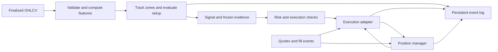

# Architecture and data contracts

This is a proposed integration design, not an audit of the existing implementation. The repository README describes a crypto scalping platform; verify its current interfaces before selecting concrete file paths. Keep this strategy separate from the existing Minute Black and other strategy definitions.

## Components

| Component | Responsibility |
|---|---|
| Market-data adapter | Historical bars, finalized live bars, quotes, instrument metadata |
| Data validator | Continuity, ordering, duplicates, value checks, warmup |
| Feature engine | ATR, confirmed pivots, volume baseline |
| Zone detector | Base/displacement recognition and frozen zone records |
| Setup evaluator | Trend, liquidity association, first touch, rejection, signal |
| Portfolio risk service | Costs, size, exposure, day loss, trading mode |
| Execution adapter | Entry/protection/exit submission, fills, reconciliation |
| Position manager | Stop, target, breakeven, failed reaction, holding limit |
| Persistence and event log | Replay, restart recovery, configuration provenance |
| Research runner | Shared signal logic with a simulated execution adapter |

The feature engine and setup evaluator should be deterministic and independent of exchange credentials. They return a signal or a structured no-trade reason. They do not submit orders.

## Data flow

## Minimum records

| Record | Required fields |
|---|---|
| Candle | Symbol, timeframe, UTC open/close times, OHLC, volume, finalized flag, source |
| Pivot | Kind, price, pivot time/index, confirmation time/index |
| Zone | ID, symbol, base indices, bounds, displacement time, availability time, ATR, status, first-touch time, expiry |
| Setup context | Zone ID, frozen pivots, trend low, liquidity price/time, target pivot, parameter version |
| Signal | ID, strategy/version, symbol, side, signal time, reference entry, ATR, target, all predicate values |
| Order intent | Client ID, signal ID, role, side, quantity, trigger/limit price, lifecycle state |
| Fill | Exchange trade/order IDs, quantity, price, fee/currency, execution time |
| Position | Entry, filled/open quantity, initial stop/R, active stop, target, protective order IDs, breakeven acknowledgment |
| Trade result | Exit reason, gross/net P&L, total fees, slippage, funding, duration, initial R |

Use decimal-safe quantities/prices at the execution boundary. Store timestamp units explicitly. Track base volume consistently; do not mix base and quote volume in the volume ratio.

## Decision visibility

Candidate displays should show trend evidence, zone bounds, reference low, first-touch status, volume ratio, rejection shape, ATR stop distance, target, estimated costs, and the first failed eligibility rule. Avoid presenting a predicted win probability without a separately calibrated model.

Suggested reason codes: `WARMUP`, `DATA_GAP`, `NO_UPTREND`, `NO_ZONE`, `NO_LIQUIDITY_REFERENCE`, `ZONE_EXPIRED`, `ZONE_INVALID`, `FIRST_TOUCH_FAILED`, `NO_SWEEP`, `NO_RECLAIM`, `WEAK_REJECTION`, `LOW_VOLUME`, `NO_TARGET`, `LOW_REWARD_RISK`, `STALE_SIGNAL`, `STALE_QUOTE`, `PRICE_DRIFT`, `SIZE_TOO_SMALL`, `RISK_HALTED`, `ORDER_UNCERTAIN`, `PROTECTION_FAILED`.

Store all failed signal predicates for research even when the UI displays only the first reason.

## Recovery contract

On restart, load persisted intents and query actual positions, normal orders, and protective/conditional orders through the adapter. Reconcile before enabling new entries. Restore an existing position's original R, target, and acknowledged stop; do not reconstruct them from current ATR. Alert on unmatched exposure and enter recovery.

Keep secrets out of signal logs, screenshots, and documentation. This documentation task does not require reading `.env`.
